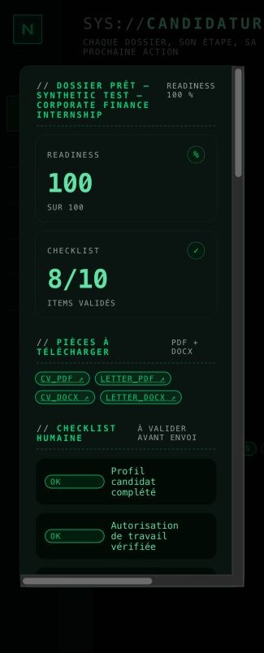
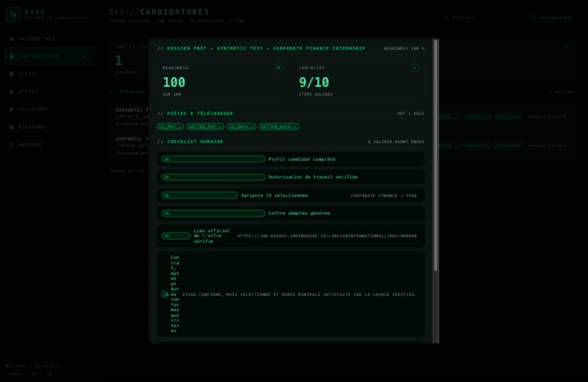

# P0 candidature facile — recette du 26 octobre 2026

**Verdict: parcours navigateur trois interactions NON VALIDÉ.**

## Périmètre effectivement exécuté

- Backend candidat `33d72c7`, puis correctif d'échéance `a177000` après redémarrage.
- UI desktop figée au commit OpenCode `f8344bad0e2c9036f95fa435e11db718f31dd138`.
- Serveur Uvicorn isolé `127.0.0.1:18924`, DB temporaire, profil et offres marqués synthétiques, fournisseur simulé. Le port habituel 8765 est resté intact.
- La fixture du chemin nominal utilise la logique canonique de source/qualification; readiness=100, aucun block_reason. Les URLs ATS sont synthétiques et n'ont pas été ouvertes. Aucun dépôt externe.

## Preuves HTTP API

| Vérification exécutée | Résultat |
|---|---|
| POST Apply Kit, langue `en` | 200, documents complets, approbation initiale fausse |
| POST approbation avec draft_id et review_token | 200, version affichée approuvée |
| POST déclaration humaine `channel=website` | 201; aucun envoi externe |
| Rejeu identique de déclaration | 201, created=false; un seul suivi |
| Exports CV/lettre PDF et DOCX | quatre HTTP 200; signatures PDF et archive DOCX vérifiées |
| Arrêt gracieux puis redémarrage réel d'Uvicorn | déclaration et suivi uniques conservés; stage submitted |
| Relecture de l'échéance après correctif | checklist cohérente avec la date future |

[Résultats API](p0-e2e-2026-10-26/api-three-actions.json) et [preuve de redémarrage](p0-e2e-2026-10-26/restart-proof.json).

Ces appels HTTP ne sont pas présentés comme un parcours navigateur réussi.

## Constats navigateur réels (IAB)

1. Navigation Candidatures et clic Préparer: modal chargé, quatre liens d'export présents.
2. Langue du dossier: non proposée explicitement par ce snapshot UI (POST `{}`; français implicite).
3. Aperçu des documents et approbation de version: absents du modal; il ouvre directement un lien officiel sans POST /approve.
4. Clic « marqué envoyé »: erreur JavaScript `prompt() is not supported`, app.js:608. Aucun POST de confirmation n'a été déclenché. Le code utilise en outre `site`, refusé par le contrat API qui attend `website`.
5. Navigation Suivi après déclaration synthétique par API et redémarrage: page vide. Cause confirmée: `render(view)` ne dispatch pas `tracking` vers `renderTracking()`.
6. Export CV PDF cliqué dans le navigateur: attente d'événement download expirée après 10 s. Le téléchargement navigateur n'est donc pas prouvé; les quatre exports HTTP ci-dessus sont valides.
7. Viewport 325 px: scrollWidth=613 px; sept boutons de navigation sans nom accessible. searchBox.hidden=true, mais computed display=flex.
8. Viewport desktop 1460×950: la colonne du libellé « Contrat, dates et durée… » mesure 21 px contre 583 px pour la note; le texte devient une colonne de lettres.

[Console navigateur](p0-e2e-2026-10-26/browser-errors-f8344ba.json).

## Suite attribuée

OpenCode: langue explicite, aperçu/revue/version, confirmation dans le modal sans prompt/alert, dispatch Suivi, followup_draft, export navigateur, responsive et noms accessibles. Codex: backend et tests; aucun fichier desktop partagé modifié.

Le backend des échéances a été corrigé après reproduction de deux tests rouges: `tests/test_apply_kit.py` passe maintenant 10 tests en 3,33 s; Ruff Career est vert. Le lot précédent de fraîcheur/revue passe 64 tests ciblés en 17,49 s.

La recette doit être rejouée sur le prochain commit UI. Le serveur et l'onglet de cette recette ont été arrêtés/fermés; le viewport d'origine a été restauré. Aucune suite complète exécutée.
