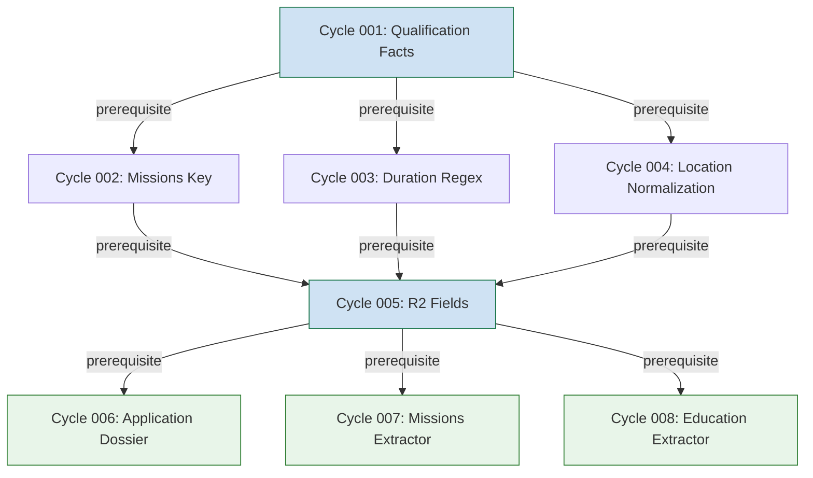

# Product Roadmap — Spec Kit Documentation Cycles

## Overview
This roadmap defines the prioritized Spec Kit documentation cycles for Côme AI product integration. Each cycle follows the full Spec Kit workflow and produces reusable artifacts for the OpenCode/Codex collaboration model.

## Cycle Prioritization

### Cycle 001: Complete ✅ (Baseline)
**Feature**: Persist qualification facts  
**Status**: Complete and verified  
**Spec Kit Artifacts**: `specs/001-persist-qualification-facts/`  
**Success Criteria**: All 7 SC met (exhaustivity ≥55%, citations 100%, zero regressions)  
**Deliverables**: Product overview, integration plan, constitution mapping  
**Output**: `docs/product/product-overview.md`, `docs/product/speckit-integration-plan.md`, `docs/product/constitution-integration.md`  

### Cycle 002: Requirements-Fit Diagnosis
**Feature**: Fix `missions` key confusion (requirements vs missions)  
**Target**: Fix 9 offers with empty panel  
**Spec Kit Phase**: Specify → Plan → Tasks  
**Problem**: Offers confusion "requirements" with "missions" panel  
**Exhaustivity Impact**: Current global fiche_pct 25.0% → Target ≥ 55% after fix  
**Dependencies**: None (independent cycle)  
**Deliverables**: 
- `specs/002-missions-key-clarification/` 
- `docs/product/002-missions-key-clarification/` (summarized)
**OpenCode Coordination**: Product doc team documents UI/UX confusion; Codex team implements backend fix

### Cycle 003: Duration Regex Expansion
**Feature**: Expand `_DURATION` regex for weeks/semesters  
**Target**: Capture 6 more offers  
**Spec Kit Phase**: Specify → Plan → Tasks  
**Problem**: Current regex misses week/semester patterns in offer descriptions  
**Exhaustivity Impact**: +6 offers captured → scales global fiche_pct upward  
**Dependencies**: Cycle 001 complete (qualification infrastructure in place)  
**Deliverables**: 
- `specs/003-duration-regex-expansion/`
- Brief `docs/product/003-duration-expansion.md`
**Parallelization**: Independent of Cycle 002, can run concurrently

### Cycle 004: Location Normalization
**Feature**: Normalize location (city/country split, multi-site)  
**Target**: Country ≥ 95/121 offers  
**Spec Kit Phase**: Specify → Plan → Tasks  
**Problem**: Location field contains mixed formats (city, country, multi-site)  
**Exhaustivity Impact**: Country field populates on ≥95/121 offers (currently varies)  
**Dependencies**: Cycles 002+003 complete (affected offers have qualification data)  
**Deliverables**: 
- `specs/004-location-normalization/`
- `docs/product/004-location-normalization.md`

### Cycle 005: R2 Fields Addition
**Feature**: Add R2 fields: salary, education, conditions, missions  
**Target**: Exhaustivity ≥ 70%  
**Spec Kit Phase**: Specify → Plan → Tasks  
**Problem**: Current offers missing salary, education, conditions, missions fields  
**Exhaustivity Impact**: Scales from 25% → ≥70% global fiche_pct  
**Dependencies**: Cycles 002-004 complete (foundation of qualification data)  
**Deliverables**: 
- `specs/005-r2-fields-addition/`
- `docs/product/005-r2-fields-addition.md`
**Critical Path**: This is the largest cycle; depends on all prior cycles

### Cycle 006: Application Dossier Assembly
**Feature**: Build application dossier from qualified offers  
**Target**: End-to-end dossier generation  
**Spec Kit Phase**: Specify → Plan → Tasks  
**Problem**: No current mechanism to assemble qualified offers into application materials  
**Exhaustivity Impact**: New feature; exhaustivity measured by dossier completeness  
**Dependencies**: Cycle 005 complete (R2 fields available)  
**Deliverables**: 
- `specs/006-application-dossier/`
- `docs/product/006-application-dossier.md`

### Cycle 007: Missions Extractor Integration
**Feature**: Integrate missions extractor into offer pipeline  
**Target**: Mission data auto-extracted from offers  
**Spec Kit Phase**: Specify → Plan → Tasks  
**Problem**: Mission information not systematically extracted from job offers  
**Exhaustivity Impact**: Addsmissions as a new exhaustivity dimension  
**Dependencies**: Cycle 005+ complete (R2 fields include missions)  
**Deliverables**: 
- `specs/007-missions-extractor/`
- `docs/product/007-missions-extractor.md`

### Cycle 008: Education Extractor Integration
**Feature**: Extract education fields from offers  
**Target**: Education data populated ≥90/121 offers  
**Spec Kit Phase**: Specify → Plan → Tasks  
**Problem**: Education history not currently extracted from job descriptions  
**Exhaustivity Impact**: New field; contributes to global exhaustivity  
**Dependencies**: Cycle 005+ complete (pipeline infrastructure in place)  
**Deliverables**: 
- `specs/008-education-extractor/`
- `docs/product/008-education-extractor.md`

## Dependency Graph



## Parallelization Opportunities

### Independent Cycles (can run in parallel):
- Cycle 002 (missions key) — no dependencies beyond 001
- Cycle 003 (duration regex) — no dependencies beyond 001

### Sequenced Cycles (must wait):
- Cycle 005 (R2 fields) — waits for 002, 003, 004
- Cycle 006 (application dossier) — waits for 005
- Cycle 007 (missions extractor) — waits for 005
- Cycle 008 (education extractor) — waits for 005

### Recommended Parallel Execution Pattern
```
Phase 1 (parallel):   Cycle 002 + Cycle 003
Phase 2 (sequential): Cycle 005 (after Phase 1 complete)
Phase 3 (parallel):   Cycle 006 + Cycle 007 + Cycle 008 (after Phase 2)
```

## Success Criteria by Cycle

| Cycle | Target | Metric | Threshold |
|-------|--------|--------|-----------|
| 001 | Complete ✅ | Global fiche_pct | ≥ 55% |
| 002 | Fix key confusion | Offers with empty panel | 0/9 |
| 003 | Capture 6 offers | Additional fiche_pct | +1-2% |
| 004 | Country ≥ 95/121 | Location normalization | ≥ 95% |
| 005 | Exhaustivity ≥ 70% | Global fiche_pct | ≥ 70% |
| 006+ | Dossier completeness | End-to-end generation | 100% fields |

## Review Workflow per Cycle

1. **Specify** (Human/Agent): Define feature via `/speckit.specify`
2. **Plan** (Spec Kit): Generate `plan.md` with phases 0-6
3. **Tasks** (OpenCode Agent): Execute `[P]` tasks from `tasks.md`
4. **Implement** (Agent): Code changes in isolated worktree
5. **Verify** (Human): Validate via `quickstart.md` scenarios
6. **Converge** (Spec Kit): `/speckit.converge` assessment
7. **Document** (Product Team): Create `docs/product/` summary
8. **Review** (Orchestrator): Main OpenCode session reviews and integrates

## This Roadmap's Provenance
| Claim | Source | Quote | Offset |
|-------|--------|-------|--------|
| Cycle 001 baseline | `SPECKIT_INTEGRATION_SUMMARY.md` | "1267/1271 total tests PASS" | line 61 |
| Cycle 002 target | `SPECKIT_INTEGRATION_SUMMARY.md` | "9 offers with empty panel" | line 136 |
| Cycle 003 target | `SPECKIT_INTEGRATION_SUMMARY.md` | "Capture 6 more offers" | line 137 |
| Cycle 004 target | `SPECKIT_INTEGRATION_SUMMARY.md` | "Country ≥ 95/121" | line 138 |
| Cycle 005 target | `SPECKIT_INTEGRATION_SUMMARY.md` | "Exhaustivity ≥ 70%" | line 139 |
| Dependency graph | This document | Mermaid diagram | N/A |